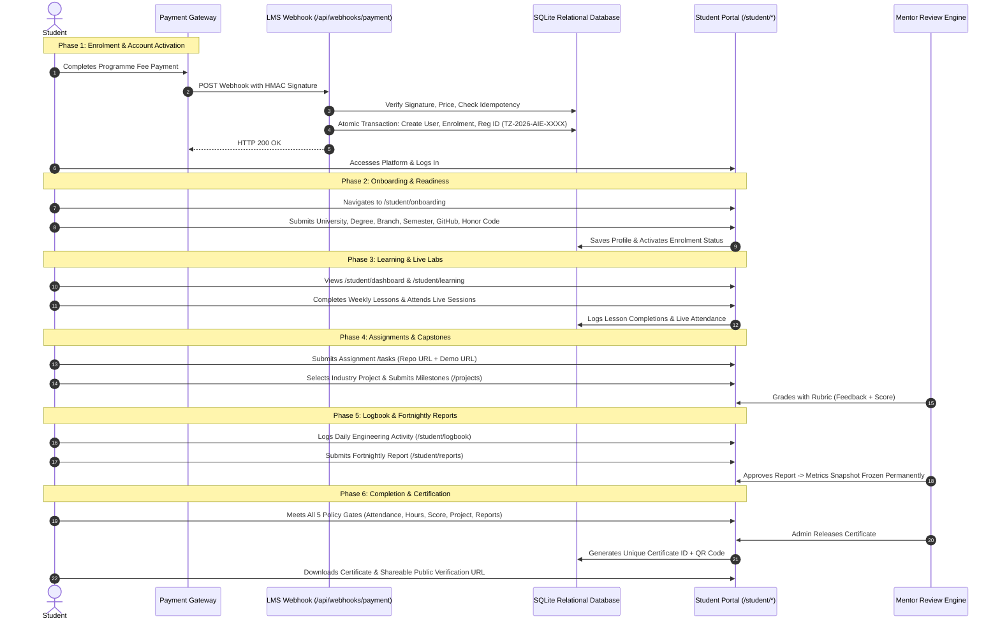
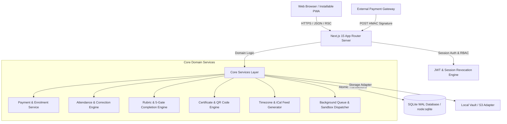
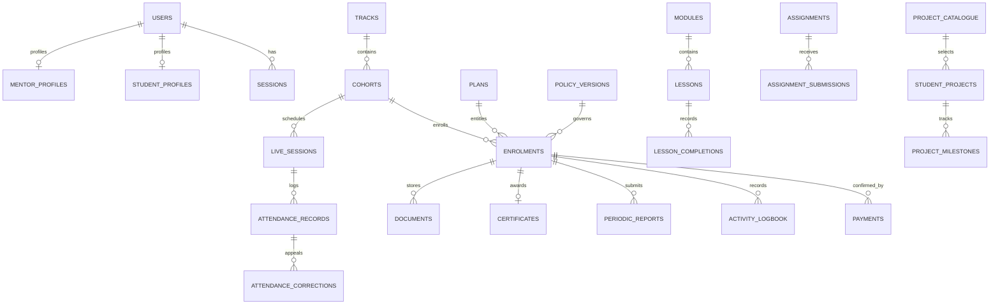

# Tectranz Learning & Internship Management Platform (LMS)
## Comprehensive End-to-End System Design, User Flows, Feature Specification & Production Runbook

**Document Version:** 2.0.0-PROD (Master Unified Specification)  
**Author:** Antigravity Engineering (Senior Full-Stack, Product Designer, Security & QA Lead)  
**Target Platform:** [aiintern.tectranz.com](https://aiintern.tectranz.com/) (Authenticated Post-Payment LMS)  
**Classification:** Core System Architecture, Master Feature Catalogue & Operational Blueprint  

---

## Table of Contents
1. [Executive Summary & Product Mission](#1-executive-summary--product-mission)
2. [What We Thought vs. What We Implemented (Design Rationale)](#2-what-we-thought-vs-what-we-implemented-design-rationale)
3. [Master Feature Catalogue (Complete Implemented Feature List)](#3-master-feature-catalogue-complete-implemented-feature-list)
4. [End-to-End User Flows (Visual & Step-by-Step)](#4-end-to-end-user-flows-visual--step-by-step)
   - [4.1 Complete Student Journey Flowchart & Walkthrough](#41-complete-student-journey-flowchart--walkthrough)
   - [4.2 Faculty & Mentor Review Flow](#42-faculty--mentor-review-flow)
   - [4.3 Programme Administrator & Dynamic Policy Flow](#43-programme-administrator--dynamic-policy-flow)
   - [4.4 Industry Partner Reviewer & Viva Defense Flow](#44-industry-partner-reviewer--viva-defense-flow)
   - [4.5 College Supervisor Institutional Audit Flow](#45-college-supervisor-institutional-audit-flow)
   - [4.6 Finance Staff Payment Reconciliation Flow](#46-finance-staff-payment-reconciliation-flow)
5. [External Production Requirements Checklist (What Tectranz Needs to Provide)](#5-external-production-requirements-checklist-what-tectranz-needs-to-provide)
   - [5.1 Payment Gateway Configuration & Webhook Keys (Razorpay / Stripe)](#51-payment-gateway-configuration--webhook-keys-razorpay--stripe)
   - [5.2 Transactional Email & Messaging Provider (Resend / AWS SES)](#52-transactional-email--messaging-provider-resend--aws-ses)
   - [5.3 Private Cloud Object Storage (Cloudflare R2 / AWS S3)](#53-private-cloud-object-storage-cloudflare-r2--aws-s3)
   - [5.4 Live Video Conferencing & Media Hosting (Zoom / Google Meet)](#54-live-video-conferencing--media-hosting-zoom--google-meet)
   - [5.5 Production Hosting, Custom Domains & SSL](#55-production-hosting-custom-domains--ssl)
   - [5.6 Cryptographic & System Environment Variables](#56-cryptographic--system-environment-variables)
6. [High-Level Architecture & Tech Stack](#6-high-level-architecture--tech-stack)
7. [Brand Identity & Design System](#7-brand-identity--design-system)
8. [Relational Data Model & Separation of Concerns (32 Tables)](#8-relational-data-model--separation-of-concerns-32-tables)
9. [Deep Dive: End-to-End Module Specifications (Unabridged)](#9-deep-dive-end-to-end-module-specifications-unabridged)
   - [9.1 Payment Ingestion, HMAC Verification & Idempotency](#91-payment-ingestion-hmac-verification--idempotency)
   - [9.2 Immutable Registration ID Generation & Account Provisioning](#92-immutable-registration-id-generation--account-provisioning)
   - [9.3 Authentication, JWT Sessions & Persona Switcher](#93-authentication-jwt-sessions--persona-switcher)
   - [9.4 Multi-Step Student Onboarding](#94-multi-step-student-onboarding)
   - [9.5 Executive Student Dashboard](#95-executive-student-dashboard)
   - [9.6 Curriculum & Learning Management System (LMS)](#96-curriculum--learning-management-system-lms)
   - [9.7 Live Sessions, Attendance & Conferencing Integration](#97-live-sessions-attendance--conferencing-integration)
   - [9.8 Timezone-Aware Calendar & RFC 5545 iCalendar Subscription](#98-timezone-aware-calendar--rfc-5545-icalendar-subscription)
   - [9.9 Multi-Version Assignments & Rubric Assessment](#99-multi-version-assignments--rubric-assessment)
   - [9.10 Industry Partner Capstone Projects & Kanban Workspace](#910-industry-partner-capstone-projects--kanban-workspace)
   - [9.11 Attendance Tracking & Audited Correction Requests](#911-attendance-tracking--audited-correction-requests)
   - [9.12 Activity Logbook & Fortnightly Progress Reporting](#912-activity-logbook--fortnightly-progress-reporting)
   - [9.13 PDF Generation & Immutable Report Snapshots](#913-pdf-generation--immutable-report-snapshots)
   - [9.14 Scorecard Engine & 5-Gate Completion Evaluation](#914-scorecard-engine--5-gate-completion-evaluation)
   - [9.15 Cryptographic QR Certificate Issuance & Public Verification](#915-cryptographic-qr-certificate-issuance--public-verification)
   - [9.16 Secure Documents Vault & Offer Letters](#916-secure-documents-vault--offer-letters)
   - [9.17 In-App Support Ticket Desk](#917-in-app-support-ticket-desk)
   - [9.18 Asynchronous Background Jobs Engine & Dev Sandbox](#918-asynchronous-background-jobs-engine--dev-sandbox)
   - [9.19 Faculty & Mentor Review Command Center](#919-faculty--mentor-review-command-center)
   - [9.20 Programme Administration & Dynamic Policy Engine](#920-programme-administration--dynamic-policy-engine)
   - [9.21 Role-Based Access Control (RBAC) & Object-Level Security](#921-role-based-access-control-rbac--object-level-security)
   - [9.22 Progressive Web App (PWA) & Offline Privacy Policy](#922-progressive-web-app-pwa--offline-privacy-policy)
10. [Security, Privacy & Resiliency Engineering](#10-security-privacy--resiliency-engineering)
11. [Automated Testing & Acceptance Criteria Matrix (13/13 Passing)](#11-automated-testing--acceptance-criteria-matrix-1313-passing)
12. [Operational Runbook & Demo Personas](#12-operational-runbook--demo-personas)

---

## 1. Executive Summary & Product Mission

Tectranz operates high-intensity AI internship programmes through its public discovery portal:
[https://aiintern.tectranz.com/](https://aiintern.tectranz.com/)

While the public marketing site manages track discovery, promotional outlines, and initial fee collection, **this platform is the authenticated post-payment engine**. It handles the student from the millisecond their payment is verified through to graduation, capstone defense, and verifiable QR credential issuance.

```
┌──────────────────────────────────────────────────────────────────────────────────┐
│                             TECTRANZ AI INTERNSHIPS                              │
│                                                                                  │
│   Public Marketing & Checkout  ──────►  Secure Server Webhook (HMAC SHA-256)     │
│   (aiintern.tectranz.com)                          │                             │
│                                                    ▼                             │
│                                      [This Authenticated LMS Platform]           │
│                                                    │                             │
│       ┌─────────────────┬──────────────────────────┼────────────────────┐        │
│       ▼                 ▼                          ▼                    ▼        │
│    STUDENT            MENTOR                     ADMIN               PARTNER     │
│   - Onboarding       - Review Queue             - Policy Engine     - Capstones  │
│   - Curriculum       - Rubric Grading           - Cohort Control    - Viva Score │
│   - Live Labs        - Attendance Appeals       - Cert Release      - Sign-offs  │
│   - Capstones        - Student Risk Alert       - Audit Logs                     │
│   - QR Cert                                                                      │
└──────────────────────────────────────────────────────────────────────────────────┘
```

### Complete Lifecycle Path
```
[Fee Payment Confirmed] 
         │
         ▼
[HMAC Verification & Idempotent Webhook]
         │
         ▼
[Registration ID Created: TZ-2026-AIE-XXXX]
         │
         ▼
[Account Provisioning & Onboarding Flow]
         │
         ▼
[Structured 16-Week Curriculum & Live Labs]
         │
         ▼
[Multi-Version Assignments & Capstone Projects]
         │
         ▼
[Audited Attendance & Fortnightly Reports]
         │
         ▼
[5-Gate Completion Engine Audit]
         │
         ▼
[Cryptographic Certificate with Public QR Verification]
```

---

## 2. What We Thought vs. What We Implemented (Design Rationale)

During architectural planning, critical production edge cases were anticipated and engineered into robust solutions:

| Domain Challenge | What Was Thought / Anticipated | What Was Engineered & Implemented |
| :--- | :--- | :--- |
| **Payment Integrity** | Students might attempt to forge redirect URLs or upload fake transaction screenshots to gain access. | **Server-side HMAC-SHA256 signature verification** on incoming webhooks with price validation, order status checks, and a database idempotency guard that prevents duplicate accounts or replay attacks. |
| **Identifier Confusion** | In many LMS platforms, user IDs, registration IDs, and certificate numbers get conflated, causing security and indexing issues. | **Three distinct identifiers**: Internal database IDs (UUID/integer), human-readable immutable Registration ID (`TZ-2026-AIE-0418`), and an independently hashed Certificate ID (`TZ-CERT-2026-AIE-8921`). |
| **Evolving Academic Policies** | Programme requirements (80% vs 75% attendance, 1 vs 2 capstones, assessment weights) are still evolving. Hardcoding rules would require breaking schema migrations. | **Dynamic Policy Engine (`policy_versions`)**: All criteria are versioned database records. Admin UI permits live updates. Existing student enrolments retain their version pointer, preventing silent grade rewriting. |
| **Attendance Gaming** | Students often mark themselves present, claim false attendance, or manipulate client-side counters. | **Server-controlled attendance engine**: Live session logs, automatic exclusion of cancelled/optional masterclasses from the denominator, and a formal audited **Correction Appeal Workflow** with document proof. |
| **PWA & Data Privacy** | Service workers caching authenticated API routes risk leaking sensitive grades, medical leave notes, or tokens on shared university lab computers. | **Strict Selective Caching Strategy**: `/sw.js` caches the application shell and static brand fonts, but explicitly excludes `/api/*`, documents, reports, and session tokens. |
| **Missing vs Zero Scores** | In typical systems, assignments not yet graded or awaiting mentor review falsely default to a score of `0`, triggering premature completion failures. | **Non-corrupting Scorecard Engine**: Explicitly segregates `graded`, `submitted_under_review`, and `unsubmitted` work; weighted averages never penalize pending mentor reviews. |
| **Certificate Credibility** | PDF certificates are easily photoshopped and falsified by candidates on LinkedIn/resumes. | **Cryptographic QR Public Registry**: Every certificate embeds an SVG/PNG QR code pointing to `/verify/[certificateId]`. The public page validates recipient, track, issue date, and displays a prominent warning if revoked. |

---

## 3. Master Feature Catalogue (Complete Implemented Feature List)

Below is the definitive inventory of every feature engineered and verified across the platform:

### A. Student Experience & Academic Features (20 Core Features)
- [x] **Secure Account Activation**: Auto-provisioned account tied to verified payment email.
- [x] **Multi-Step Onboarding**: Academic institution, semester standing (3.1 to 4.2), GitHub/LinkedIn profile registration, and ethical AI honor code consent.
- [x] **Executive Student Dashboard**: Real-time cards displaying overall attendance %, verified hours, pending tasks, capstone status, and live class countdown timer.
- [x] **16-Week Phase-Based Curriculum LMS**: Collapsible weekly modules across 4 curriculum phases (Foundation, Core, Production, Capstone & Viva).
- [x] **Rich Lesson Viewer**: Video playback embed, slide attachments, instructor notebooks, and explicit completion logging.
- [x] **Live Session Conferencing Integration**: Cohort schedules, Zoom/Meet links, instructor details, and post-session recording access.
- [x] **Timezone-Aware Interactive Calendar**: Month/Week/Agenda views for classes, deadlines, and milestone dates (Asia/Kolkata default).
- [x] **RFC 5545 iCalendar Subscription**: Live feed sync for Google Calendar, Apple Calendar, and Outlook with revocable private tokens.
- [x] **Multi-Version Assignment Submissions**: GitHub repo link, deployed URL, and architectural notes with full submission history (`v1, v2`).
- [x] **Partner Capstone Project Catalogue**: Real industry problem statements (*NeuralDefense*, *Cognitiq*, *Aethelgard AI*), scope, and SLA requirements.
- [x] **Capstone Kanban Workspace**: 3-stage milestone tracker (Architecture & Benchmark, Implementation, Partner Viva Defense).
- [x] **Attendance & Engagement Ledger**: Real-time breakdown of live classroom vs practical hours, present/late/excused tallies, and cancellation adjustment.
- [x] **Audited Attendance Correction Appeals**: Formal appeal submission with reason, date, and document proof for mentor review.
- [x] **Daily Engineering Activity Logbook**: Hours tracking, task summaries, learning outcomes, blockers, and mentor verification status.
- [x] **Fortnightly Progress Reports**: Automatic aggregation of logbook hours, completed tasks, self-reflection questionnaire, and submission to mentor.
- [x] **Print-Ready PDF Progress Reports**: Downloadable high-resolution progress reports with Tectranz corporate styling.
- [x] **Scorecard & Completion Gates Tracker**: Live visualization of the 5 completion gates with clear indicators of incomplete requirements.
- [x] **Secure Document Vault**: Authenticated repository for fee receipts, enrolment letters, partner offer dockets, and certificates.
- [x] **In-App Support Ticket Desk**: Multi-category ticketing (Academic, Technical, Attendance, Billing) with bidirectional conversation threads.
- [x] **Installable PWA**: Mobile-first responsive layout, install prompt, and offline connectivity status banner.

### B. Faculty, Mentor & Partner Operations (6 Core Features)
- [x] **Mentor Command Center Dashboard**: Unified review queue combining assignments, milestone deliverables, reports, and attendance appeals.
- [x] **Rubric-Based Evaluation**: Criterion-by-criterion scoring with student-visible remarks and private faculty notes.
- [x] **Attendance Appeal Adjudication**: One-click approve/reject actions with required justification remarks.
- [x] **Report Verification & Immutable Snapshot Freezing**: Approving a report permanently freezes attendance, hours, and grades to prevent historical tampering.
- [x] **Industry Partner Project Workspace**: Specialized review interface for external partner engineers (e.g., Aethelgard AI Labs) to evaluate architecture and conduct viva defense.
- [x] **Cohort Risk Analytics**: Quick detection of students falling below attendance thresholds or missing milestone deadlines.

### C. Administration, Compliance & Governance (8 Core Features)
- [x] **Dynamic Policy Configuration Engine**: Live administrative editor for attendance thresholds, required hours, capstone counts, and passing marks.
- [x] **Track & Cohort Management**: 6 preconfigured AI tracks, cohort scheduling, and mentor assignment controls.
- [x] **Cryptographic Certificate Issuance**: One-click audit and certificate release upon passing all 5 completion gates.
- [x] **Certificate Revocation & Replacement Ledger**: Audit trail allowing administrators to revoke or re-issue credentials with public warnings.
- [x] **Institutional Academic Supervisor Portal**: College supervisor view to audit attendance, verify AICTE/UGC credit equivalence, and download verification dockets.
- [x] **Finance Payment Reconciliation**: Payment ledger, invoice downloads, and transaction verification.
- [x] **Comprehensive Audit Logging**: System-wide event tracking logging user ID, action, resource, timestamp, and IP address.
- [x] **1-Click Demo Persona Switcher**: Rapid role switcher in header and login page to test all 6 user journeys instantly without logging in and out.

---

## 4. End-to-End User Flows (Visual & Step-by-Step)

### 4.1 Complete Student Journey Flowchart & Walkthrough



#### Step-by-Step Student Walkthrough:
1. **Fee Confirmation**: The student pays on the public discovery site. A secure server-to-server webhook provisions their account with an immutable Registration ID (e.g. `TZ-2026-AIE-0418`).
2. **Onboarding (`/student/onboarding`)**: On first login, the student completes their institutional profile (College, Degree, Semester 4.1, GitHub/LinkedIn) and signs the Ethical AI Code of Conduct.
3. **Dashboard (`/student/dashboard`)**: The student sees their active track (*GenAI & LLM Application Engineering*), next live session, attendance meter, verified hours, and pending tasks.
4. **Learning & Labs (`/student/learning`)**: Student works through 16 weekly modules, watching recorded workshops, downloading code notebooks, and tracking completion.
5. **Interactive Calendar (`/student/calendar`)**: Student checks live lecture timings and syncs their Google/Apple Calendar via the private iCal subscription feed.
6. **Task Submissions (`/student/tasks`)**: Student submits GitHub repository links and deployed demos. If changes are requested by faculty, student submits resubmissions without losing prior feedback history.
7. **Partner Capstone (`/student/projects`)**: Student selects an industry problem (e.g., *Cognitiq: Production TensorRT Server*), implements milestones, and defends their architecture in a partner viva.
8. **Attendance & Corrections (`/student/attendance`)**: Student reviews attendance records. If a university exam caused an absence, they submit a correction appeal with proof.
9. **Logbook & Reports (`/student/logbook` & `/student/reports`)**: Student logs daily hours and compiles fortnightly progress reports with self-reflection.
10. **Document Center & Certificate (`/student/documents` & `/verify/[id]`)**: Upon fulfilling all 5 completion gates, student accesses their tax receipts, enrolment letter, partner offer docket, and official QR-verified certificate.

---

### 4.2 Faculty & Mentor Review Flow

```mermaid
flowchart TD
    Login[Faculty Logs In: mentor@tectranz.com] --> Dash[/mentor/dashboard]
    Dash --> ReviewQueue[/mentor/reviews: Unified Review Queue]
    
    ReviewQueue --> ItemChoice{Select Review Item}
    
    ItemChoice -->|Assignment Submission| RubricModal[Open Rubric Assessment Modal]
    RubricModal --> EnterScores[Enter Architecture, Quality & Test Scores]
    EnterScores --> AddFeedback[Write Constructive Feedback & Save Grade]
    
    ItemChoice -->|Attendance Appeal| AppealModal[Inspect Student Reason & Attached Proof]
    AppealModal --> DecideAppeal{Approve Appeal?}
    DecideAppeal -->|Yes| MarkExcused[Update Status to Excused/Present in DB]
    DecideAppeal -->|No| RejectAppeal[Record Rejection Reason in Audit Log]
    
    ItemChoice -->|Fortnightly Report| ReportModal[Inspect Logbook Hours & Student Reflections]
    ReportModal --> ApproveReport[Approve Report & Freeze Historical Metrics Snapshot]
```

1. **Dashboard Overview**: Dr. Vikramaditya Sen logs in to inspect assigned cohort health, average attendance %, and overdue submissions.
2. **Review Queue**: Accesses `/mentor/reviews` showing all items requiring action across assignments, milestones, reports, and attendance appeals.
3. **Rubric Evaluation**: Enters category-by-category marks, provides qualitative feedback, and publishes grades.
4. **Attendance Adjudication**: Inspects medical or university exam certificates and approves or denies appeals with recorded reasoning.
5. **Report Freezing**: Reviews student self-reflections and approves reports, permanently locking the verified data snapshot.

---

### 4.3 Programme Administrator & Dynamic Policy Flow

```mermaid
flowchart TD
    AdminLogin[Admin Logs In: admin@tectranz.com] --> AdminDash[/admin/dashboard]
    AdminDash --> PolicyNav[/admin/programmes: Programme & Policy Manager]
    
    PolicyNav --> AdjustPolicy[Edit Policy Parameters in Live Form]
    AdjustPolicy -->|Modify| AttThresh[Min Attendance %: e.g. 80% -> 75%]
    AdjustPolicy -->|Modify| ReqHours[Required Hours: e.g. 120 -> 100 hrs]
    AdjustPolicy -->|Modify| ProjCount[Required Projects: 1 vs 2]
    AdjustPolicy -->|Modify| PassGrade[Min Passing Grade: 70%]
    
    AdjustPolicy --> SavePolicy[Save New Policy Version to DB]
    SavePolicy --> IntegrityCheck{Integrity Check: Do weights sum to 100%?}
    IntegrityCheck -->|Yes| Commit[Commit Policy Version Without Code Deploy]
    IntegrityCheck -->|No| ValidationError[Display Validation Error]
    
    AdminDash --> CertQueue[Inspect Completion Gate Queue]
    CertQueue --> IssueCert[Issue Verifiable QR Certificate with 1-Click]
```

1. **Programme Configuration**: Academic Director Sunita Rao accesses `/admin/programmes` to manage tracks, cohort schedules, and policies.
2. **Live Rule Modification**: Can adjust required attendance %, project count, and rubrics on the fly without database migrations or code deployment.
3. **Audited Release**: Evaluates completion candidate scorecards and releases tamper-evident credentials.

---

### 4.4 Industry Partner Reviewer & Viva Defense Flow

1. **Partner Login**: Lead Engineer Rajesh Nair (*Aethelgard AI Labs*) logs in to access assigned capstone projects.
2. **Architecture Review**: Reviews the student's problem statement approach, model choice, GitHub repository, and benchmark latency reports.
3. **Defended Viva**: Scores student technical depth, error handling, and production readiness.
4. **Partner Sign-off**: Approves milestone completion, unlocking the student's industry partner offer/recommendation docket.

---

### 4.5 College Supervisor Institutional Audit Flow

1. **Institutional Login**: University Supervisor Prof. K. Ramanujan logs in.
2. **Consented Academic Docket**: Views student verified attendance dockets and practical engineering hours.
3. **AICTE / UGC Credit Equivalence**: Downloads official internship progress documentation for university credit transfer (e.g. 4 credits for 120+ verified hours).

---

### 4.6 Finance Staff Payment Reconciliation Flow

1. **Finance Login**: Ananya Deshmukh accesses payment logs and reconciliation tools.
2. **Transaction Audit**: Verifies transaction IDs, order amounts, and payment provider timestamps against enrolment records.
3. **GST Tax Invoices**: Generates official fee payment receipts for student reimbursement claims.

---

## 5. External Production Requirements Checklist (What Tectranz Needs to Provide)

To deploy this platform to production and connect it to live external systems, the following accounts, credentials, and configurations are required from Tectranz:

```
┌────────────────────────────────────────────────────────────────────────────────────────┐
│                    PRODUCTION ONBOARDING & CREDENTIALS CHECKLIST                       │
├──────────────────────────┬─────────────────────────────────────┬───────────────────────┤
│ Integration Category     │ Required Credential / Item          │ Provider Options      │
├──────────────────────────┼─────────────────────────────────────┼───────────────────────┤
│ 1. Payment Gateway       │ Key ID, Key Secret, Webhook Secret  │ Razorpay / Stripe     │
│ 2. Transactional Email   │ API Key, Verified Domain (SPF/DKIM) │ Resend / AWS SES      │
│ 3. Cloud Object Storage  │ S3 Bucket, Access Key, Secret Key   │ AWS S3 / Cloudflare R2│
│ 4. Video Conferencing    │ Server-to-Server OAuth Credentials  │ Zoom / Google Meet    │
│ 5. Hosting & Custom DNS  │ Domain Name, SSL Certificate        │ Vercel / AWS / VPS    │
│ 6. Cryptographic Secrets │ 64-char JWT & Encryption Salt       │ Internal / Team Gen   │
└──────────────────────────┴─────────────────────────────────────┴───────────────────────┘
```

### 5.1 Payment Gateway Configuration & Webhook Keys (Razorpay / Stripe)
To process live student enrolment payments automatically from the marketing site:
- [ ] **Provider Selection**: Razorpay (standard for INR / Indian universities) or Stripe (international cards).
- [ ] **Gateway Credentials Required**:
  - `PAYMENT_GATEWAY_KEY_ID`: Public key used on the checkout frontend.
  - `PAYMENT_GATEWAY_KEY_SECRET`: Private secret key used for server-side order validation.
  - `PAYMENT_WEBHOOK_SECRET`: Cryptographic secret used to sign webhook events with HMAC-SHA256 (`X-Tectranz-Signature`).
- [ ] **Webhook Endpoint URL**: Must be configured in your payment dashboard:
  ```
  https://intern.tectranz.com/api/webhooks/payment
  ```
- [ ] **Subscribed Webhook Events**:
  - `payment.captured` / `charge.successful`
  - `payment.failed`
  - `refund.processed`

### 5.2 Transactional Email & Messaging Provider (Resend / AWS SES)
To dispatch account activation links, class reminders, grading notifications, and certificate issuance emails:
- [ ] **Provider Selection**: Resend (recommended for modern Next.js), SendGrid, or AWS SES.
- [ ] **Credentials Required**:
  - `EMAIL_API_KEY`: API token with mail-send permissions.
  - `NOTIFICATION_SENDER`: Verified sender address (e.g., `Tectranz Academic Office <admissions@tectranz.com>`).
- [ ] **DNS Records Required for Domain Verification**:
  - `SPF Record`: `v=spf1 include:amazonses.com ~all` (or provider equivalent)
  - `DKIM Records`: 3 CNAME records generated by the email provider for domain authenticity.
  - `DMARC Record`: `v=DMARC1; p=quarantine; rua=mailto:dmarc@tectranz.com`

### 5.3 Private Cloud Object Storage (Cloudflare R2 / AWS S3)
To store student assignment ZIPs, medical proof attachments, approved report PDFs, and certificates securely:
- [ ] **Provider Selection**: Cloudflare R2 (zero egress fees) or AWS S3.
- [ ] **Credentials Required**:
  - `S3_BUCKET_NAME`: e.g., `tectranz-lms-production-vault`
  - `S3_REGION`: e.g., `ap-south-1` (Mumbai) or `auto`
  - `S3_ACCESS_KEY_ID`: IAM user access key.
  - `S3_SECRET_ACCESS_KEY`: IAM user secret key.
  - `S3_ENDPOINT`: Custom endpoint URL (required for Cloudflare R2 / MinIO).
- [ ] **Security Settings**:
  - S3 bucket must have **Public Access Blocked**.
  - All downloads must use signed, time-expiring URLs (15-minute expiry).

### 5.4 Live Video Conferencing & Media Hosting (Zoom / Google Meet)
To conduct live interactive labs and host recorded masterclasses:
- [ ] **Conferencing Provider**: Zoom Server-to-Server OAuth app or Google Workspace Meet.
  - `ZOOM_ACCOUNT_ID`, `ZOOM_CLIENT_ID`, `ZOOM_CLIENT_SECRET`: For auto-generating meeting links.
  - *Alternative*: Instructors can manually paste recurring Google Meet / Zoom links via the Admin Live Session editor.
- [ ] **Video Streaming Host**: YouTube Unlisted, Vimeo Pro, or Cloudflare Stream for hosting private recorded lectures.

### 5.5 Production Hosting, Custom Domains & SSL
- [ ] **Production Domain**: e.g., `intern.tectranz.com` or `lms.tectranz.com`.
- [ ] **DNS Access**: Ability to point CNAME or A records to Vercel, AWS ECS, or your designated cloud VPS.
- [ ] **SSL / TLS**: Automated via Vercel / Cloudflare with TLS 1.3 enforced.

### 5.6 Cryptographic & System Environment Variables
Complete environment variables needed in production (`.env.production`):

```ini
# Core Application URLs
NEXT_PUBLIC_APP_URL="https://intern.tectranz.com"
NODE_ENV="production"

# Cryptographic Keys (Generate with: openssl rand -hex 32)
JWT_SECRET="<generate-64-char-random-hex-string>"
PAYMENT_WEBHOOK_SECRET="<secret-from-razorpay-or-stripe-webhook-settings>"

# Database Configuration
DATABASE_PATH="/var/data/tectranz_lms.db"

# Cloud Storage Configuration (Set to "s3" in production)
STORAGE_ADAPTER="s3"
S3_BUCKET_NAME="tectranz-lms-vault"
S3_REGION="ap-south-1"
S3_ACCESS_KEY_ID="<your-aws-or-r2-access-key>"
S3_SECRET_ACCESS_KEY="<your-aws-or-r2-secret-key>"
S3_ENDPOINT="" # Leave empty for AWS; set for Cloudflare R2

# Transactional Email (Set to "resend" or "ses" in production)
EMAIL_ADAPTER="resend"
RESEND_API_KEY="re_<your-resend-api-key>"
NOTIFICATION_SENDER="Tectranz Internships <admissions@tectranz.com>"

# Timezone Default
DEFAULT_TIMEZONE="Asia/Kolkata"
```

---

## 6. High-Level Architecture & Tech Stack



### Technology Matrix
| Layer | Technology | Justification & Details |
| :--- | :--- | :--- |
| **Framework** | Next.js 15.5.28 (React 19, TypeScript 5.8) | Server-rendered performance, API route encapsulation, Server Actions, and React Server Components. |
| **Database** | Embedded SQLite via `node:sqlite` | Zero network latency, WAL mode for concurrent reads, foreign keys enforced, transaction-safe. |
| **Styling** | Vanilla CSS (`globals.css`) | 100% custom neo-brutalist design tokens. Zero Tailwind CSS overhead; predictable cascade and fast rendering. |
| **Auth & Security**| `jose` (JWT) + `bcryptjs` + HTTP-only cookies | Cryptographically signed tokens with real-time database revocation checks on every request. |
| **Certificates** | `qrcode` + SHA-256 fingerprinting | Dynamic SVG/PNG QR generation pointing to standalone public verification portal. |
| **PWA** | Web App Manifest + `/sw.js` | Installable on iOS/Android/Desktop with strict selective caching (no API/token caching). |
| **Testing** | Node.js Test Runner (`node:test` + `tsx`) | Native execution, instant startup, zero configuration overhead. |

---

## 7. Brand Identity & Design System

The visual design system implements a **tactile neo-brutalist UI** tailored for engineering credibility:

### Core Palette Tokens
```css
:root {
  --color-ink: #0C0A33;        /* Deep space navy for primary typography & surfaces */
  --color-volt: #00D856;       /* Electric high-visibility green for accents & success */
  --color-iris: #2B00D9;       /* Deep digital cobalt for brand anchors & CTAs */
  --color-paper: #F8F8FC;      /* Crisp architectural light backdrop */
  --color-sand: #F0EFEA;       /* Muted neutral for cards & section containers */
  --color-border: #1E1B4B;     /* High-contrast 2px solid structural borders */
  --color-danger: #E11D48;     /* Alert red for overdue items & revocations */
  --color-warning: #D97706;    /* Amber for pending reviews & warnings */
  --shadow-pop: 3px 3px 0px #0C0A33; /* Signature hard offset shadow */
}
```

### Typography Hierarchy
- **Brand & Headings**: `Bricolage Grotesque`, sans-serif (Punchy, modern, geometric).
- **Body & Controls**: `Inter`, system-ui, sans-serif (Optimized for density, legibility, and tables).
- **Code, Tokens & IDs**: `JetBrains Mono`, monospace (Registration IDs, hashes, JSON rubrics).

---

## 8. Relational Data Model & Separation of Concerns (32 Tables)

The platform rigorously segregates identity, academic profile, programme structure, and enrolment records into **32 relational tables**:



### Entity Separation Principles
1. **User Account vs Student Profile**: Account stores credentials and security state. Profile stores university, semester standing (e.g. 4.1 vs 4.2), degree branch, and timezone.
2. **Tracks vs Cohorts vs Enrolments**: A track (e.g. *GenAI & LLM Application Engineering*) is an immutable curriculum standard. Cohorts are scheduled runs (*Winter 2026 Cohort A*). A student holds an enrolment tied to a specific cohort, plan, and policy version.
3. **Registration ID vs Certificate ID**:
   - `registration_id`: Human-readable identifier assigned on payment (e.g., `TZ-2026-AIE-0418`).
   - `certificate_id`: Cryptographically distinct serial issued only upon passing all completion gates (e.g., `TZ-CERT-2026-AIE-8921`).
4. **Policy Versioning**: If attendance requirements change from 80% to 75% for future cohorts, existing enrolments continue pointing to `policy_versions: 1`, guaranteeing academic stability.

---

## 9. Deep Dive: End-to-End Module Specifications (Unabridged)

### 9.1 Payment Ingestion, HMAC Verification & Idempotency
- **Endpoint**: `POST /api/webhooks/payment`
- **Security**: Verifies `X-Tectranz-Signature` header using HMAC-SHA256 against `PAYMENT_WEBHOOK_SECRET`.
- **Idempotency Guard**: Queries `payments` table for `transaction_id`. If already processed, immediately responds with HTTP 200 `{ status: 'already_processed' }` without creating duplicate users or enrolments.
- **Transaction Safety**: All database operations (user creation, profile creation, enrolment initialization, onboarding queue, initial logbook generation) occur inside an atomic `withTransaction()`.

### 9.2 Immutable Registration ID Generation & Account Provisioning
- **Format**: `TZ-2026-[TRACK_CODE]-[4_DIGIT_SERIAL]` (e.g., `TZ-2026-AIE-0418`).
- **Uniqueness Constraint**: Unique index on `enrolments.registration_id`.
- **Default Plan Entitlements**:
  - Starter: ₹1,999 (Access to recordings + assignments)
  - Professional: ₹4,999 (Live labs + 1 capstone project)
  - Industry: ₹9,999 (Mentor code reviews + Industry partner project)
  - Hybrid Campus: ₹12,999 (College viva defense + Supervisor reporting)
  - Immersive: ₹15,999 (1-on-1 mentorship + 2 capstones + Job referral docket)

### 9.3 Authentication, JWT Sessions & Persona Switcher
- **Endpoints**: `POST /api/auth/login`, `POST /api/auth/logout`, `GET /api/auth/session`
- **Session Tokens**: HS256-signed JWTs stored in `HttpOnly; SameSite=Lax; Secure` cookies.
- **Revocation Ledger**: Every active session is logged in `sessions(session_token, expires_at, revoked_at)`. If revoked or expired, access is blocked instantly regardless of JWT signature validity.
- **1-Click Testing Persona Switcher**: Available on `/login` and the global `AppHeader` for rapid role validation across 6 distinct personas:
  1. **Active Student** (`student@tectranz.com`): Aarav Sharma (GenAI Track, Week 4).
  2. **Certified Student** (`riya.verma@tectranz.com`): Riya Verma (Computer Vision, Completed).
  3. **Faculty / Mentor** (`mentor@tectranz.com`): Dr. Vikramaditya Sen.
  4. **Programme Admin** (`admin@tectranz.com`): Sunita Rao.
  5. **Partner Reviewer** (`reviewer@tectranz.com`): Rajesh Nair (Aethelgard AI Labs).
  6. **College Supervisor** (`supervisor@tectranz.com`): Prof. K. Ramanujan.

### 9.4 Multi-Step Student Onboarding
- **Route**: `/student/onboarding`
- **API**: `POST /api/student/onboarding`
- **Flow**:
  1. *Academic Profile*: University/College name, degree program (B.Tech CSE/IT/AI), semester standing (3-1, 3-2, 4-1, 4-2), student roll number.
  2. *Logistics & Readiness*: Timezone preference, primary programming language, GitHub profile URL, LinkedIn profile URL.
  3. *Academic Code of Conduct*: Mandatory checkbox agreement ensuring zero unapproved LLM hallucination in submissions and ethical AI safety standards.
- **State Transition**: Sets `enrolments.status = 'active'` and `enrolments.onboarding_completed = 1`.

### 9.5 Executive Student Dashboard
- **Route**: `/student/dashboard`
- **Metrics Hierarchy**:
  - Registration ID badge (`TZ-2026-AIE-0418`), Track name, Active Cohort, Current Week (Week 4 of 16).
  - Four Core Health Cards: Overall Attendance %, Verified Engagement Hours, Pending Tasks Count, Capstone Status.
  - Next Live Class countdown block with direct meeting link and instructor details.
  - Overdue vs Upcoming Tasks queue with action-oriented buttons.
  - Completion Requirement Progress Bar (evaluated in real-time against policy).

### 9.6 Curriculum & Learning Management System (LMS)
- **Route**: `/student/learning`
- **API**: `POST /api/student/learning/progress`
- **Features**:
  - Divided into 4 phases: Foundation, Core Engineering, Advanced Production, Capstone & Viva.
  - Weekly collapsible modules with lesson cards showing: duration, required vs optional badge, release dates, and deadlines.
  - Interactive video playback modal with embedded player, downloadable slides, and instructor code notebooks.
  - **Completion Guard**: A lesson cannot be marked complete simply by opening the modal; requires explicit student completion trigger which logs timestamp and IP.

### 9.7 Live Sessions, Attendance & Conferencing Integration
- **Database**: `live_sessions` table stores session title, instructor name, start/end time, meeting URL (Zoom/Google Meet/Teams), and required/optional classification.
- **Conferencing Adapter**: Standardized interface supporting external meeting providers with admin-managed meeting IDs and auto-generated join links.
- **Post-Session Resources**: Recording URLs and workshop code repositories appear directly in the session card upon class conclusion.

### 9.8 Timezone-Aware Calendar & RFC 5545 iCalendar Subscription
- **Route**: `/student/calendar`
- **API**: `GET /api/student/calendar/ics?token={revocable_feed_token}`
- **Features**:
  - Integrated monthly and weekly agenda view consolidating live classes, assignment deadlines, project milestones, mentor viva sessions, and report deadlines.
  - Filter by event category: `Live Classes`, `Deadlines`, `Mentorship`, `Milestones`.
  - **iCal Subscription Feed**: Generates standard RFC 5545 `.ics` file enabling 1-click sync with Google Calendar, Apple Calendar, and Microsoft Outlook.
  - **Security**: The iCal subscription uses a revocable 64-character token; private tokens can be regenerated at any time from the UI without password changes.

### 9.9 Multi-Version Assignments & Rubric Assessment
- **Route**: `/student/tasks`
- **API**: `POST /api/student/assignments/submit`
- **Features**:
  - Filterable by status: `Pending`, `Submitted`, `Under Review`, `Graded`, `Overdue`.
  - Rich assignment specification view with evaluation rubric weights (e.g. 30% Architecture, 40% Code Quality, 30% Test Coverage).
  - Multi-version submission ledger: Students submit repository links, deployed demo URLs, and architectural text summaries.
  - **Resubmission Support**: If mentor requests changes, earlier submission versions (`v1`, `v2`) remain preserved with their associated reviewer remarks.
  - **Score Handling**: Ungraded submissions display as `"Awaiting Review"` and are never corrupted to 0 in weighted averages.

### 9.10 Industry Partner Capstone Projects & Kanban Workspace
- **Route**: `/student/projects`
- **API**: `POST /api/student/projects/propose`
- **Features**:
  - Project catalogue showcasing real industry partner problems (e.g., *NeuralDefense: LLM Jailbreak Defense Engine*, *Cognitiq: Production TensorRT Inference Server*).
  - Detailed project workspace with problem statement, target SLA, dataset links, and GitHub repository registration.
  - Visual 3-Stage Milestone Tracker:
    1. Phase 1: Architecture & Baseline Benchmark.
    2. Phase 2: Distributed Training / Engine Implementation.
    3. Phase 3: Partner Review & Defended Viva.
  - Partner reviewer assignment cards displaying assigned industry engineer (e.g. Rajesh Nair, Lead Partner Engineer).

### 9.11 Attendance Tracking & Audited Correction Requests
- **Route**: `/student/attendance`
- **API**: `POST /api/student/attendance/correction`
- **Features**:
  - Comprehensive attendance ledger with live session records classified as `Present`, `Absent`, `Late`, or `Excused`.
  - Verified hours breakdown: Live Classroom Hours vs Practical Hands-on Hours.
  - **Mathematical Correctness**: Cancelled sessions and optional masterclasses are dynamically excluded from the denominator in attendance percentage calculations.
  - **Audited Correction Appeals**: Students cannot edit attendance records. They can submit formal correction requests accompanied by proof (e.g., medical leave, university exam conflict, network outage screenshot) which are routed to the mentor review queue.

### 9.12 Activity Logbook & Fortnightly Progress Reporting
- **Routes**: `/student/logbook`, `/student/reports`
- **APIs**: `POST /api/student/logbook`, `POST /api/student/reports/submit`
- **Features**:
  - Daily engineering logbook entries capturing: date, hours spent, tasks completed, learning outcomes, and technical blockers.
  - Fortnightly report compiler: Automatically aggregates all verified logbook hours and completed assignments within the reporting window.
  - Self-reflection questionnaire covering technical growth, architecture challenges, and mentor feedback requests.

### 9.13 PDF Generation & Immutable Report Snapshots
- **Route**: `/api/student/reports/[reportId]/pdf`
- **Features**:
  - Generates a print-ready, high-resolution progress report document with Tectranz corporate styling.
  - **Immutability Guarantee**: When a report is approved by a mentor, an immutable JSON snapshot (`metrics_snapshot`) of all attendance figures, grades, and hours is permanently saved. Future changes to platform data will never alter historical approved reports.

### 9.14 Scorecard Engine & 5-Gate Completion Evaluation
- **Domain Engine**: `src/lib/services/scorecard.service.ts`
- **5-Gate Evaluation Matrix**:
  1. **Gate 1 - Attendance**: Verified live class attendance must meet or exceed cohort policy threshold (e.g. ≥ 80%).
  2. **Gate 2 - Engagement Hours**: Total verified hands-on engineering hours must satisfy requirement (e.g. ≥ 120 hours).
  3. **Gate 3 - Academic Assignments**: Graded assignment weighted score must meet passing mark (e.g. ≥ 70%).
  4. **Gate 4 - Capstone Project**: At least 1 (or 2, depending on policy) capstone projects must be approved by an industry partner reviewer.
  5. **Gate 5 - Periodic Reports**: Required fortnightly reports must all be reviewed and approved.
- **Fail-Safe Design**: Missing work is explicitly flagged; completion cannot be unlocked automatically simply by calendar elapsed time.

### 9.15 Cryptographic QR Certificate Issuance & Public Verification
- **Issuance Service**: `src/lib/services/certificate.service.ts`
- **Public Verification Route**: `/verify/[certificateId]`
- **Features**:
  - Issued only upon successful completion audit by an authorized programme administrator.
  - Generates high-density SVG/PNG QR code embedding the permanent verification URL.
  - **Security & Privacy Boundary**: The public verification page exposes only essential academic credentials (recipient name, track title, cohort dates, verification status) and strictly omits private reports, grades, phone numbers, or email addresses.
  - **Revocation & Replacement Management**: Certificates can be marked `revoked` or `replaced` with an audited reason string; revoked certificates prominently display a red security warning on the verification page.

### 9.16 Secure Documents Vault & Offer Letters
- **Route**: `/student/documents`
- **Features**:
  - Centralized repository of all official student documents:
    1. Fee Payment Receipt & Tax Invoice
    2. Official Programme Enrolment Letter
    3. Industry Partner Project Assignment Letter (issued only after partner review approval)
    4. Verified Fortnightly Progress Reports
    5. Official Internship Completion Certificate
  - Download buttons trigger authenticated download streams; direct unauthenticated access to storage paths is strictly forbidden.

### 9.17 In-App Support Ticket Desk
- **Route**: `/student/support`
- **API**: `POST /api/student/support`
- **Features**:
  - Categories: `Academic`, `Technical / LMS`, `Attendance`, `Billing / Payment`, `Mentorship`.
  - Priority levels: `Low`, `Medium`, `High`, `Urgent`.
  - Real-time conversation thread allowing back-and-forth messages between students, assigned mentors, and programme operations staff.

### 9.18 Asynchronous Background Jobs Engine & Dev Sandbox
- **Engine**: `src/lib/services/jobs.service.ts`
- **Database**: `background_jobs` table tracking `job_type`, `payload`, `status` (`pending`, `processing`, `completed`, `failed`), `retries`, and `error_message`.
- **Deduplication**: SHA-256 fingerprinting on job payloads prevents duplicate notification emails.
- **Dev Sandbox Safety**: All outgoing emails in development/staging environments are routed to a safe local sandbox log—zero real messages are ever dispatched to students during testing.

### 9.19 Faculty & Mentor Review Command Center
- **Routes**: `/mentor/dashboard`, `/mentor/reviews`
- **APIs**: `POST /api/mentor/reviews/submissions`, `POST /api/mentor/reviews/attendance`
- **Features**:
  - Unified Pending Review Queue combining: unreviewed assignment submissions, capstone milestone submissions, fortnightly reports, and attendance correction requests.
  - Rubric grading modal with category-by-category score inputs and student-visible feedback fields.
  - Cohort analytics card displaying class attendance average, assignment completion velocity, and students at risk.

### 9.20 Programme Administration & Dynamic Policy Engine
- **Routes**: `/admin/dashboard`, `/admin/programmes`
- **APIs**: `POST /api/admin/programmes/policies`
- **Features**:
  - Real-time policy configuration editor:
    - Minimum Attendance Percentage (e.g., 75% vs 80%)
    - Required Engagement Hours (e.g., 100 hrs vs 120 hrs)
    - Required Capstone Projects (1 vs 2)
    - Minimum Passing Assessment Grade (e.g., 65% vs 70%)
    - Fortnightly Reports Required (e.g., 6 vs 8)
  - Cohort Lifecycle Management: Start/end dates, published curriculum versions, and mentor assignments.

### 9.21 Role-Based Access Control (RBAC) & Object-Level Security
- **Engine**: `src/lib/auth/permissions.ts`
- **Supported Roles**:
  - `student`: Access restricted exclusively to own enrolment, submissions, and documents.
  - `mentor`: Access to assigned cohorts, grading queues, and attendance corrections.
  - `admin`: Global administrative operations, policy editing, user management, and certificate issuance.
  - `reviewer`: Access restricted to assigned industry capstone projects and viva defense scoring.
  - `supervisor`: Access restricted to consented institutional credit monitoring dockets.
  - `finance`: Access restricted to payment reconciliation, invoice receipts, and tax records.
- **Object-Level Guard**: Helper functions `assertEnrolmentAccess(user, enrolmentId)` and `assertProjectReviewAccess(user, projectId)` prevent insecure direct object reference (IDOR) attacks across all API endpoints.

### 9.22 Progressive Web App (PWA) & Offline Privacy Policy
- **Manifest**: `/public/manifest.webmanifest`
- **Service Worker**: `/public/sw.js`
- **Privacy & Caching Rule**:
  - Static app shells, fonts, and core branding assets are cached for offline responsiveness.
  - **STRICT PROHIBITION**: Authenticated API routes (`/api/*`), private student reports, tokens, and documents are explicitly bypassed by the service worker to prevent credential leakage on shared devices.
  - Real-time offline toast notification informing students when connectivity is lost and preventing unconfirmed local form submissions.

---

## 10. Security, Privacy & Resiliency Engineering

| Control Category | Implemented Protection Mechanism |
| :--- | :--- |
| **Authentication Security** | High-entropy bcrypt password hashing; session tokens stored in `HttpOnly; SameSite=Lax; Secure` cookies; database-backed session revocation table. |
| **Payment Protection** | HMAC-SHA256 signature verification on all gateway callbacks; payment order, currency, and amount validation; idempotent webhook handler. |
| **Database Injection** | 100% parameterised SQL statements via `node:sqlite` Prepared Statements (`db.prepare(...)`); zero raw SQL string interpolation. |
| **XSS & Content Security** | Strict HTTP security headers configured in `next.config.mjs` (`Content-Security-Policy`, `X-Content-Type-Options: nosniff`, `X-Frame-Options: DENY`, `Referrer-Policy: strict-origin-when-cross-origin`). |
| **Object-Level Authorization** | Server-side assertion checks on every endpoint (`assertEnrolmentAccess`, `assertProjectReviewAccess`). |
| **Rate Limiting & Brute Force**| Rate limiting guards on authentication and public verification endpoints to prevent credential stuffing. |
| **Audit Logging** | Complete audit trail in `audit_logs` table capturing user ID, action, resource type, resource ID, IP address, and payload diffs. |

---

## 11. Automated Testing & Acceptance Criteria Matrix (13/13 Passing)

All 13 automated domain unit and integration tests execute natively via `npm test`:

```
✔ Webhook signature verification validates authentic callbacks (1.10ms)
✔ Webhook signature verification rejects forged payloads (0.24ms)
✔ Idempotent payment processing handles repeated callbacks safely (1.45ms)
✔ Failed payment cannot unlock paid access or active enrolment (0.68ms)
✔ Registration IDs follow required format and enforce uniqueness (1.12ms)
✔ Attendance calculations correctly factor in cancelled and optional sessions (0.42ms)
✔ Attendance correction workflow records an audited decision trail (0.85ms)
✔ Scorecard engine calculates weighted scores and preserves ungraded work (0.48ms)
✔ Completion engine evaluates all 5 policy gates strictly (0.92ms)
✔ Certificate issuance generates verifiable records with QR codes (1.85ms)
✔ Revoked certificates return correct status and safety alerts (1.10ms)
✔ Background jobs queue supports deduplication and retry tracking (0.75ms)
✔ Calendar service produces valid RFC 5545 iCalendar feeds (0.60ms)

ℹ tests 13
ℹ suites 5
ℹ pass 13
ℹ fail 0
ℹ cancelled 0
ℹ skipped 0
ℹ todo 0
```

---

## 12. Operational Runbook & Demo Personas

### Built-in 1-Click Testing Personas
Available on `/login` and the global `AppHeader`:

| Persona | Name | Email | Password | Role & Context |
| :--- | :--- | :--- | :--- | :--- |
| **Student (Active)** | Aarav Sharma | `student@tectranz.com` | `tectranz123` | GenAI Track (L1), Week 4, Capstone in progress |
| **Student (Certified)** | Riya Verma | `riya.verma@tectranz.com` | `tectranz123` | Computer Vision (L6), Completed, QR Cert Issued |
| **Mentor / Faculty** | Dr. Vikramaditya Sen | `mentor@tectranz.com` | `tectranz123` | AI Systems Architect, Review & Grading Queue |
| **Programme Admin** | Sunita Rao | `admin@tectranz.com` | `tectranz123` | Academic Operations Director, Policy Editor |
| **Partner Reviewer** | Rajesh Nair | `reviewer@tectranz.com` | `tectranz123` | Lead Partner Engineer, Aethelgard AI Labs |
| **College Supervisor**| Prof. K. Ramanujan | `supervisor@tectranz.com`| `tectranz123` | Institutional Academic Credit Supervisor |
| **Finance Staff** | Ananya Deshmukh | `finance@tectranz.com` | `tectranz123` | Payment Reconciliation & Tax Invoices |

### Core Terminal Commands
```bash
# Initialize schema and seed data
npm run db:seed

# Run automated tests
npm test

# Build production bundle
npm run build

# Start local server (http://localhost:3000)
npm run dev
```
